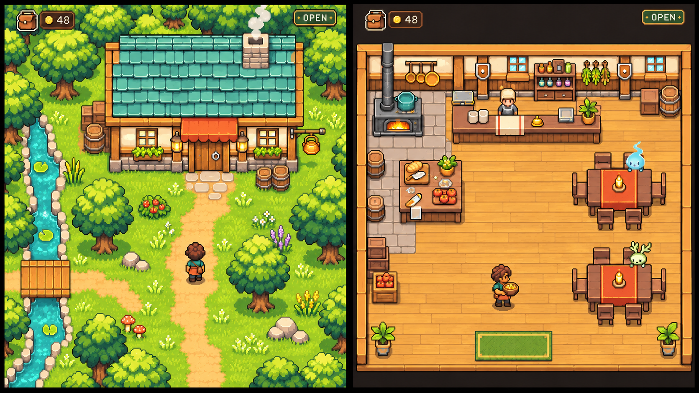

# Approved Copperfern gameplay art reference

**Owner-selected direction: original Copperfern pixel art with a high top-down RPG camera and the approved brighter starting-region palette.** Published for the development team as the visual target. Read this before using older concept images.

[Open full-size image](art-direction/copperfern-approved-top-down-reference.png)

## What to match

- High top-down / three-quarter, non-isometric camera on rectangular terrain. Show substantial ground, floor, roof and furniture-top surfaces. Keep vertical front faces shallow; avoid the earlier low/frontal illustrated-diorama view.
- The same player, camera, pixel density and believable prop scale outdoors and indoors. Doorways, chairs, counter access and walkways must fit the actor.
- Original Copperfern identity: teal/russet clothing, expressive dark curly hair, ingredient satchel, warm horizontal timber, teal roof/shutters, restrained copper and stepped forest masses.
- Bright, cheerful starting-region daylight: fresh greens, golden leaf highlights, pale ochre paths, turquoise water, ivory plaster and honey-colored wood. Teal and terracotta accents retain Copperfern identity. Keep selective shadows for readability; avoid dark/sepia washes and blanket orange lighting.
- Sunny readable forest approaches and a welcoming daylight tavern with cooking, preparation, serving and seating areas. Quiet walking surfaces and distinctive interaction silhouettes.
- Deliberate pixel clusters, coherent material ramps, nearest-neighbor rendering, stable foot origins and real four-direction animation.

The main-region style is selected. Future regions may vary ecology, materials and atmosphere while retaining the shared camera, density and readability contract in [ART_REGIONAL_STYLE.md](ART_REGIONAL_STYLE.md).

The brighter image supersedes the previous muted version at the same reference path; the older image remains in Git history. Stardew Valley informed the requested cheerful daylight mood, not asset designs or an exact palette to copy.

## How to use this reference

Follow [.agents/skills/hollow-hearth-pixel-art/SKILL.md](../.agents/skills/hollow-hearth-pixel-art/SKILL.md) and [ART_PRODUCTION_PIPELINE.md](ART_PRODUCTION_PIPELINE.md). The previous player study supplies appearance detail; earlier low-angle scene concepts supply materials only. Tiny 16×30 studies are archived comparisons, not the selected production style. No older illustration or provisional dimension may override this camera choice.

Pixel Crawler was studied for camera, asset organization and modular construction. The current decision is our own art. Do not assume its pack is a production dependency or copy its characters, tiles or map layouts. See [ASSET_PROVENANCE.md](ASSET_PROVENANCE.md) for the selected image's generation inputs and limitations.

## What is still to validate

This image is a visual mockup, not a Godot screenshot, exact-size sprite sheet, seamless tile atlas or validated map. It does not establish native viewport, tile size, visible character dimensions, animation canvas, palette indices, collisions or actual UI. Those must be chosen together in one native-scale player + forest + tavern benchmark in the actual slice. The extra chef/guest designs, displayed currency and OPEN labels are illustrative, not new gameplay requirements.

Production gate: inspect the existing slice and engine, author original native pixels, test terrain seams, four-direction movement, carrying, station clearance, foot collisions, Y-sorting and canopy/wall occlusion. Preserve the game plan and its one-forest/one-tavern scope. No full asset batch before this coherent benchmark passes.
