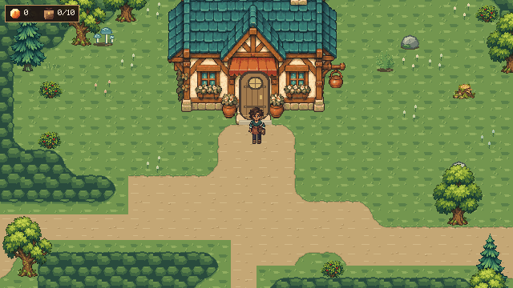
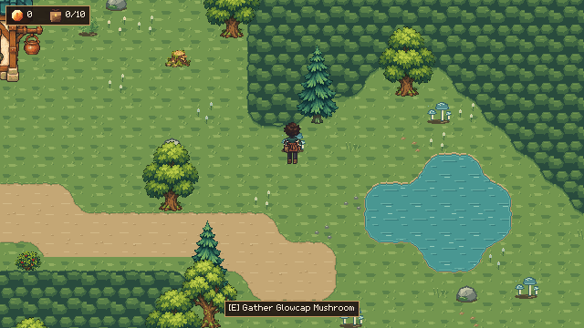
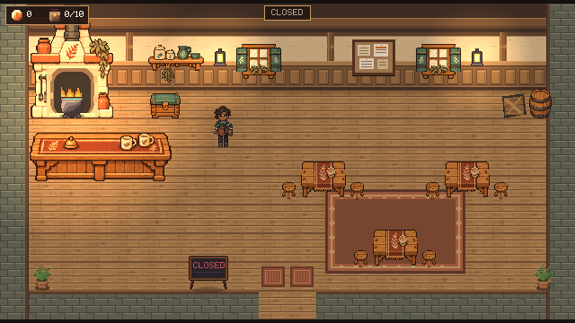
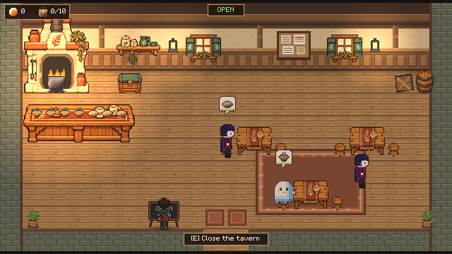
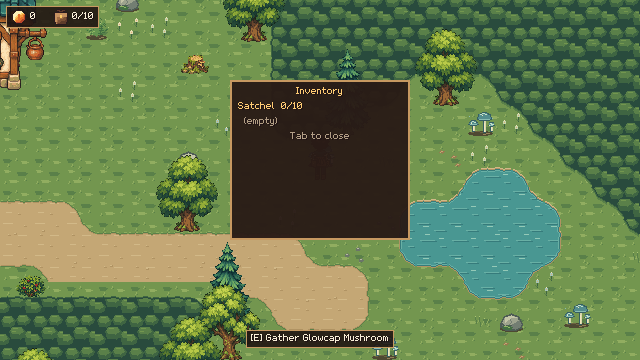
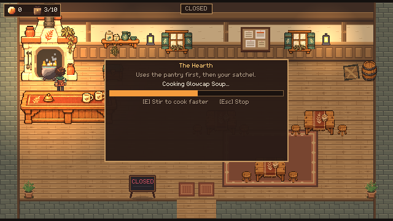
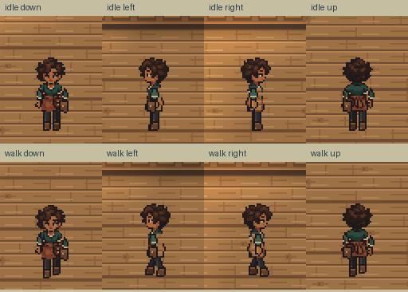

# Codex v2 — independent Copperfern visual benchmark

**Review candidate, not approved for expansion.** Branch `feat/art-codex-v2`. This is the existing playable game with new original native assets, not the earlier separate art-test project or a generated scene backdrop. No merge into main.

## Frozen comparison contract

| Setting | Used |
|---|---|
| Playable baseline | `a8085de9a969daed1f44f0e3bc6ed88a0c6615a1` (`feat/vertical-slice`) |
| Approved reference | main commit `c1600fb04df167ff0a250a20a7ac3abb4894d9e6`, `docs/ART_REFERENCE.md` and its Copperfern image |
| Engine | Godot `4.7.2.stable.official.ed1daf0bf`, official Linux build; release SHA-512 verified |
| Native viewport / renderer | 640×360, GL Compatibility, nearest filtering, integer viewport stretch |
| Terrain / character | 32×32 terrain; 48×64 character cells; 5 columns ×4 directions; foot `(24,60)` and existing Sprite offset `(-24,-61)` |
| Camera / layouts | High top-down/three-quarter, non-isometric; baseline camera, zoom, scene positions, map files and collision footprints unchanged |
| Independence | No Claude candidate or third-party pack artwork used; only frozen baseline interfaces and approved project art direction |

The specified reference commit is pinned here even though later main documentation and palette studies exist. The image is a direction/reference illustration, not an exact native atlas or the same aspect-ratio/layout as the frozen game. No camera or furniture rearrangement was made to imitate its composition.

## See it running

All scene PNGs below are native **Godot viewport captures**, at the shared baseline coordinates. Source art was converted into individual runtime sprites and semantic tile atlases; no full-scene illustration is used as a background.

| Forest entrance | Forest gathering area |
|---|---|
|  |  |

| Tavern interior | Customer interactions |
|---|---|
|  |  |

| Inventory readability | Cooking readability |
|---|---|
|  |  |

[Occlusion/fade capture](art-codex-v2/captures/05_tree_occlusion.png) · [Serving prompt](art-codex-v2/captures/m4_03_serve_prompt.png) · [Payment feedback](art-codex-v2/captures/m4_04_paid_coins_and_thanks.png)

## Animation evidence

These GIFs contain **rendered Godot crops**, not image-generated motion. Four directions each have idle breathing and an articulated four-pose walk. The walk captures press the real movement actions and follow the actor; idle changes only texture pose. Samples are approximately 0.12s idle /0.10s walk apart, so frame sampling is not an export of the precise runtime timeline. Movement remains 110px/s with the original 9fps walk state. Body/collision position is never moved by the idle animation.



[Full-world walking GIF](art-codex-v2/engine_world_walk.gif) · [MP4](art-codex-v2/engine_world_walk.mp4) · [Registered player sheet at3×](art-codex-v2/player_sheet_x3.png)

Individual rendered previews: [idle down](art-codex-v2/idle_down.gif), [left](art-codex-v2/idle_left.gif), [right](art-codex-v2/idle_right.gif), [up](art-codex-v2/idle_up.gif); [walk down](art-codex-v2/walk_down.gif), [left](art-codex-v2/walk_left.gif), [right](art-codex-v2/walk_right.gif), [up](art-codex-v2/walk_up.gif).

## Direct comparison

[Approved reference alongside actual forest/tavern captures](art-codex-v2/reference_vs_runtime.png). The reference is fitted without distortion; captures remain native. It is not a claim of identical framing or final visual parity.

| Approved Copperfern traits | Candidate result / remaining gap |
|---|---|
| Teal roofs, russet cloth, copper accents and warm timber | Replaced magenta placeholder roof with shaded teal tiles, timber joinery, a copper kettle sign, cream plaster and a native doorway sized for the actor. Original footprint retained. |
| Clustered canopy depth and natural ingredients | Two native oak silhouettes and a spruce, explicit full/harvested plant forms, mossy stump, bush and rock. Trees keep baseline foot rows/fade behavior. The forest is still sparser than the illustration because map and prop positions are frozen. |
| Quiet navigable paths with material detail | New seamless semantic transition tiles, tan paths, horizontal turquoise water detail, flowers/tufts/leaves and coherent canopy boundaries. More natural edge variation and less visible repetition remain desirable. |
| Refined cooking and hospitality props | Native tables, stools, counter, pantry, shelf, window, hearth, crate/rug; sparse embroidery, ceramic/copper accents and wood ramps. Some generated-source texture is still busy at native size. |
| Expressive top-down traveler | Original independent down/left/right/up bases, dark curls, teal/russet outfit, asymmetric satchel, stable feet and moving limbs. More hand cleanup of facial and profile clusters would improve polish. |
| Rich, cohesive world presentation | This is a measurable improvement over the frozen placeholder assets, not a claim to equal the approved illustration. Baseline UI, guest sprites, icons, audio and lighting settings remain; they are visibly less refined than the new hero props. |

Matched before/after images use the **same capture extension on both snapshots** with a4.2s banner-settle delay and the baseline's travel/gather/cooking/service helpers. The forest entrance camera still crops the top of the building just as the baseline does; moving the camera to show more roof would break the shared comparison.

- [Forest entrance — baseline / Codex](art-codex-v2/compare_02_forest_entrance.png)
- [Gathering — baseline / Codex](art-codex-v2/compare_03_forest_gathering.png)
- [Tavern — baseline / Codex](art-codex-v2/compare_01_tavern_interior.png)

Claude's new assets were not inspected or used, so this report does not judge its separate candidate. These frozen settings and artifacts permit that later side-by-side review.

## Tools and original-source workflow

Verified available/used: image-generation tool for original bounded direction/prop studies, Python/Pillow and ImageMagick for source inspection/native cleanup, the official pinned Godot build for real rendering and tests, FFmpeg for the rendered walking video. A local software-OpenGL virtual X display captured the real game. PixelLab was not connected; Aseprite/LibreSprite were not installed. Pixelorama was previously installed but had headless startup errors and is not claimed as the production/export tool here.

Three original source studies are retained under `assets/art/source/codex_v2/`. Native scripts explicitly crop objects, remove alpha fringe, palette-map, reconstruct limbs and doorway/cooking sockets, and preserve exact placement origins. Terrain and gatherable art are original deterministic native-pixel construction. The resulting **32 modified runtime PNGs** are inventoried with hashes in [provenance.json](../assets/art/source/codex_v2/provenance.json). See [ASSET_PROVENANCE.md](ASSET_PROVENANCE.md) for input/tool terms and unchanged-asset records. Source illustrations are not presented as production sheets, and no exclusive-rights/legal-clearance claim is made.

## Validation

- `tools/run_tests.sh`: **176 passed, 0 failed**, strict import clean and300-frame main boot clean on pinned4.7.2. Includes174 existing tests and2 new idle/walk contract tests. [Validation output](art-codex-v2/validation.txt).
- Art checks: all384 compatible dual-grid edge pairs, pure-variant borders and16 floor seam pairs; exact atlas dimensions; binary alpha in modified outputs;14 hero prop canvases/foot rows; five distinct full/harvested nodes;20 registered player frames and four distinct walking poses per direction. [Art output](art-codex-v2/art-validation.txt).
- Existing integration tests cover travel, collision, tree fade/occlusion, gathering, cooking, service, saves and inventory conservation. The only runtime code delta is visual idle-frame selection in `scenes/player/player.gd`; no gameplay systems/data, scene geometry or project settings changed.
- Automated agent session: **PASS**,3 trips,38 ingredients gathered,11 dishes cooked/served,238 earned/60 spent, satchel upgrade bought and save→title→continue intact. [Full report](art-codex-v2/playtest.md). Accelerated scripted game time4:36 is not a human playtest or measured real session duration.
- Captures: all native640×360;96 character crops across8 animation states, each visibly changes;12 full-world movement frames. [Capture log](art-codex-v2/capture-log.txt). Inspected forest, gathering, tavern, occlusion, cooking, inventory and service renders. Expected software-display V-Sync warning only; capture run logs contain no engine/script errors.
- Baseline note: the first frozen-baseline run passed174 tests but its separate forced-quit boot reported a resource at exit. The candidate's final full pipeline is clean. That intermittent baseline shutdown diagnostic is not claimed as an art fix.

No export build, mobile touch test, human playtest, final animation approval or owner visual acceptance is claimed. Collisions and fade tests plus captures establish technical compatibility, not complete coverage of every pixel/occlusion combination.

## Reproduce

```sh
# From repo root, with pinned Godot4.7.2 executable on PATH or GODOT_BIN set.
python tools/art/build_codex_v2.py
bash tools/run_tests.sh
"$GODOT_BIN" --path . res://tests/visual/capture_codex_v2.tscn -- --out=/tmp/codex-v2 --scenario=codex_v2
python tools/art/codex_v2_review.py /tmp/codex-v2 /path/to/matched-baseline-captures
"$GODOT_BIN" --headless --path . res://tests/playtest/full_session.tscn -- --out=/tmp/codex-v2-session --speed=6
```

Use a working graphical display for capture, not `--headless`. Set `--audio-driver Dummy` on machines without an audio device. Set writable XDG cache/config/data paths if the home directory is read-only. To produce matched baseline images, apply **only** the new capture helper to a separate `a8085de` snapshot and run the same scene with `--animations=no`; this does not import candidate assets. Never regenerate this candidate with baseline `build_all.py`, which intentionally recreates programmer placeholders.

Next step is owner comparison/approval. Do not expand these assets across new regions, alter the agreed scale/layout or merge into main as part of this benchmark.
