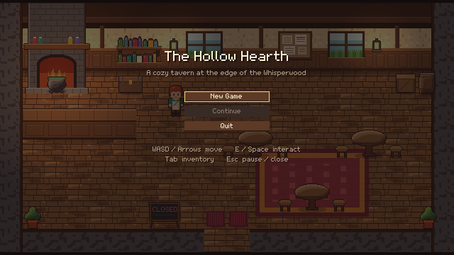
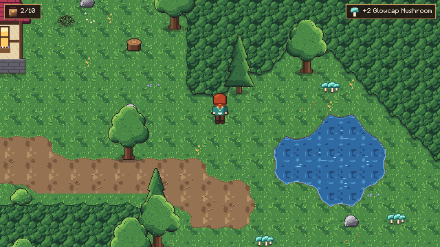
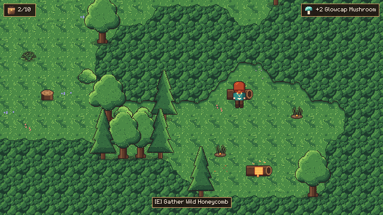
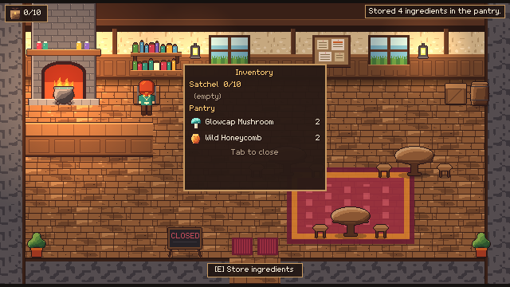
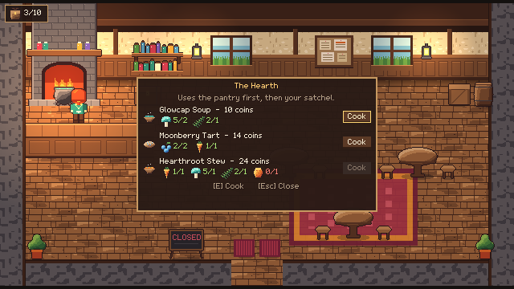
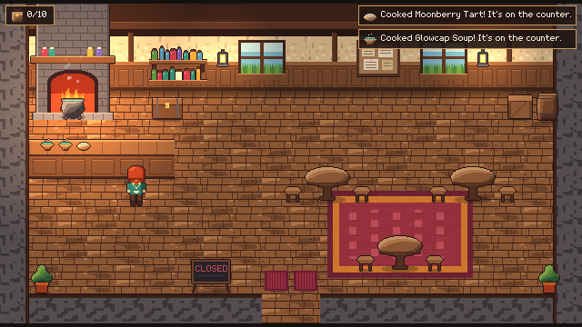
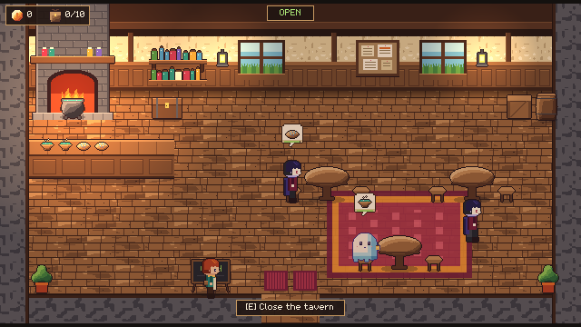
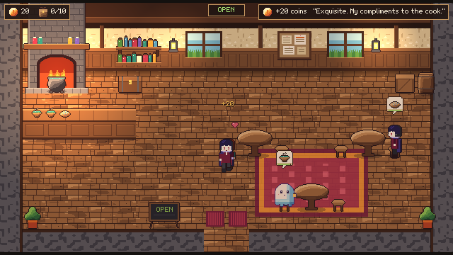
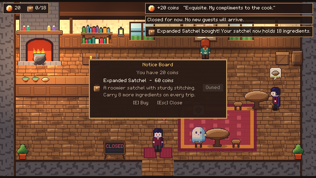
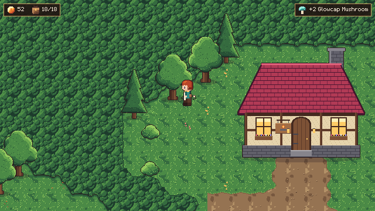

# M5 Integration & Playtest Report — 2026-11-14

Build: branch `feat/vertical-slice`, Godot 4.7.2-stable. All numbers below come from runs of the real
game; nothing is estimated unless marked **estimate**.

## What was tested, and how
| Check | How | Result |
|---|---|---|
| Rules and models | 174 automated tests (`tools/run_tests.sh`): inventory, transactions, gathering, cooking, orders, economy, saves, ledgers, audio | all pass |
| Real scenes + real input | integration tests drive `Main` with input events: movement, collisions, doors, gathering, pantry, cooking panel, sign, guests, serving, upgrade board, title, pause, save/continue | all pass |
| Whole loop, regression | `test_full_loop`: playtest agent, teleporting between targets, 6× game speed | pass: 4 trips, upgrade bought, next trip carried 18, save → title → continue intact |
| Whole loop, real movement | `tests/playtest/full_session.tscn`: agent walks everywhere (A* over physics-probed cells driving the move actions), headless 6× and windowed 2× | pass (both); report below |
| Resource / scene validation | every `.tscn`/`.tres` loads and instances; strict import with zero errors; headless boot of the real main scene | pass |
| Fresh checkout | clone → `tools/run_tests.sh` | pass |
| Visual inspection | native-resolution captures from the real renderer at each milestone (see screens below) | inspected; issues fixed or listed |
| **Human playtest** | — | **not done yet — required** |

## Real-movement session (windowed, 2× game speed)
The agent starts at the title, presses **New Game**, and plays until the satchel upgrade is bought plus
one more trip, then **Save → Quit to Title → Continue**. Full timeline: [screens/agent_session_2x_report.md](screens/agent_session_2x_report.md).

| Trip | Gathered | Cooked | Served | Coins after |
|---|---|---|---|---|
| 1 | 10 | 2 | 2 | 34 |
| 2 | 10 | 3 | 3 | 112 (then bought the satchel: −60) |
| 3 (after upgrade) | **18** | **6** | **6** | 168 |

- Game time to buy the upgrade: **2:05**; whole arc: **4:23** (headless 6× run: 2:25 / 4:35).
- Ledgers held throughout: ingredients held = gathered − used; dishes on counter = cooked − served;
  coins = earned − spent; satchel never over capacity; no negative counts.
- The upgrade is meaningful: the next trip carried 18 instead of 10 and earned ~3× the coins.

**Session length (estimate):** the agent knows every node position, never reads, and never explores.
A first-time player who explores the forest, finds the hidden glade, reads the cooking panel and
watches guests will plausibly take 2–3× as long — about **9–13 minutes** for the same arc, which is
inside the 10–15 minute target. This must be confirmed by a human playtest.

## Issues found during M5 and fixed
| Issue | Fix |
|---|---|
| Loading a damaged save logged an engine error | parse with a `JSON` instance; damaged saves are reported and never applied |
| A looping ambience still playing at shutdown was reported as a leaked resource | audio stops and lets the audio thread release playbacks on exit |
| Nearest-first gathering left unusable leftovers (18 items → 2 dishes) | not a game bug: the agent now gathers for a dish, as the cooking panel's have/need chips encourage; noted for tutorial/hints |
| Location banner overlapped the OPEN/CLOSED chip | banner moved down |
| Random archetype streaks hid one guest type for long stretches | archetypes alternate (random first) |
| Heart emote faded before the guest paid | heart shows on payment; the bubble keeps the dish while eating |

## Known issues and limitations (not fixed in the slice)
- All art and audio are generated placeholders pending the visual benchmark decision
  ([VISUAL_BENCHMARK.md](VISUAL_BENCHMARK.md)).
- Guests stand at their stool instead of sitting (no sitting pose in the placeholder sheets).
- Interacting from the south, the player's sprite covers small objects and seated guests (normal for
  3/4 view, but worth an art/UX pass: e.g. highlight outlines on the target).
- Prompts always show `[E]`, also for gamepad players.
- No options menu (volume, key remapping UI); bindings are editable in Project Settings → Input Map.
- Economy and timing values (prices, tips, 60-coin upgrade, 120 s regrowth, 80–100 s patience) are
  tuned only against agent runs.
- First-time guidance is minimal: arrival banner, title-screen controls and contextual toasts.

## Screens (real renderer, native 640×360)
| | |
|---|---|
|  |  |
|  |  |
|  |  |
|  |  |
|  |  |

## What a human playtest should answer
1. Without help, does a new player find the forest, gather, cook and open the tavern? Where do they stall?
2. Session length to the first upgrade and to a second post-upgrade trip.
3. Does service pacing feel cozy (not idle, not hectic)? Are 80–100 s of patience too generous?
4. Is the cooking stir satisfying or ignored?
5. Do the two guests feel distinct? Are orders readable at a glance?
6. Placeholder art: anything that already reads wrong at 640×360?
