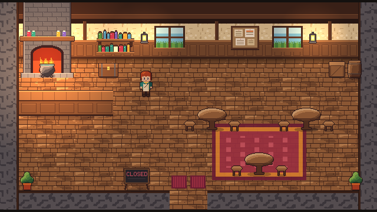
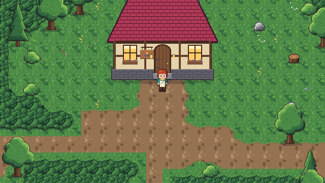
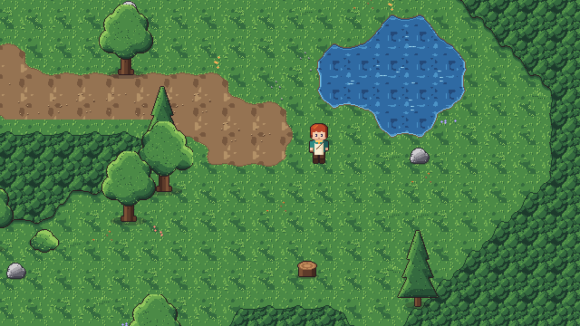
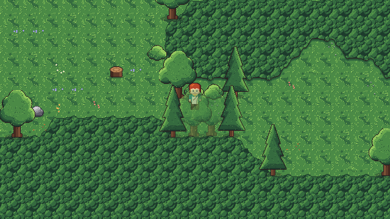
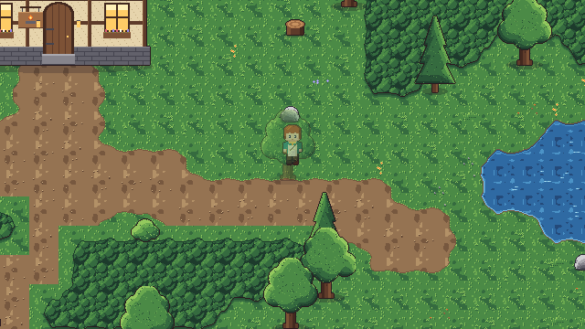
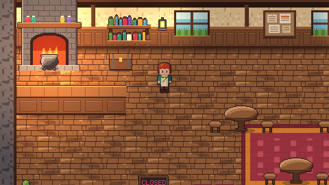
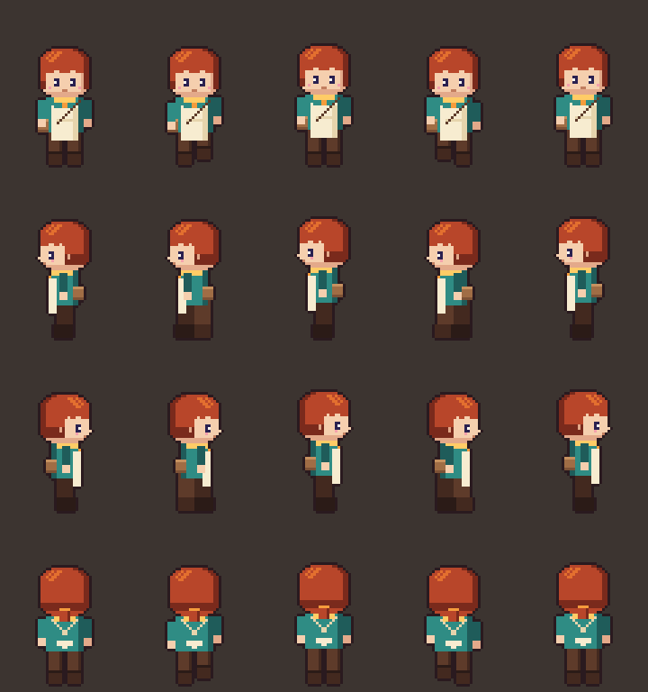
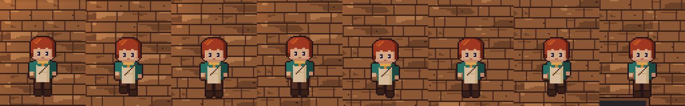
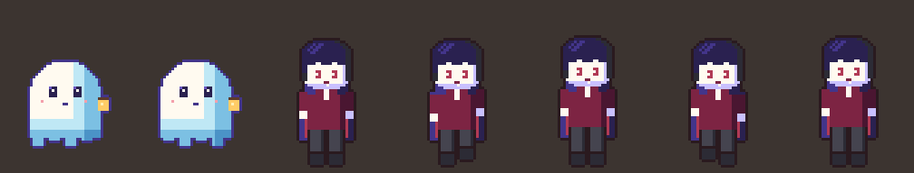

# M1 Visual Benchmark — Review Sheet

**Status: awaiting owner approval.** Gameplay milestones continue on this placeholder pipeline; no
mass production of final art happens until this gate is approved (ART_BIBLE.md, *Visual benchmark gate*).

All images are **real frames from Godot 4.7.2** (GL Compatibility renderer) captured by
`tests/visual/capture_benchmark.tscn` at native resolution — not mock-ups. Re-capture with:
`"$GODOT_BIN" --path . res://tests/visual/capture_benchmark.tscn -- --out=<dir> [--size=480x270]`

## What is being validated
| Question | Tested value | Result |
|---|---|---|
| Native viewport | 640×360, integer-scaled (2× = 720p, 3× = 1080p) | Whole tavern fits one screen; forest shows ~20×11 tiles |
| Tile grid | 32×32, rectangular, non-isometric | Seamless dual-grid transitions (path, water, canopy) |
| Character frame | 48×64 frame, ~46 px tall body, foot anchor at row 60 | Reads clearly against grass, dirt and wood |
| Scale agreement | door ≈ 56 px, table ≈ 40 px, tree ≈ 80 px vs 46 px character | Consistent after raising the tavern door from 40 → 56 px |
| Y-sorting / occlusion | origin at feet/base; tall props fade to 45% when the player is behind | Verified in-engine and by automated test |
| Pixel crispness | nearest filtering, integer stretch, pixel snapping, bitmap UI font | No blur or uneven pixels in captures |

## Screens (native 640×360)
| Tavern interior (single screen, hearth light) | Forest — tavern entrance |
|---|---|
|  |  |
| **Pond hollow (water edges)** | **Hidden passage to the glade (discovery)** |
|  |  |
| **Occlusion fade behind a tree** | **480×270 comparison (same scene)** |
|  |  |

Character sheet (3×), walk cycle (3×) and the two guest archetypes (3×):

## Recommendation
**Approve 640×360 / 32 px tiles / 48×64 character frames as the production grid.** At 480×270 the
same art is chunkier but the tavern no longer fits one screen, which works against watching several
guests at once during service. 640×360 keeps the whole room readable and integer-scales cleanly.

## What this benchmark does *not* settle
- **Final art quality.** Every asset here is programmer placeholder art generated by `tools/art/*.py`.
  It proves scale, palette discipline, layering and the import pipeline — not the Ashbound-level
  character quality bar. Production sprites need PixelLab access, an artist, or a licensed tileset
  (owner decision; no paid tools were used).
- Lighting style beyond a warm interior `CanvasModulate` + `PointLight2D` glow.
- UI art direction (current UI is a functional bitmap font and flat panels).

## Owner decisions requested
1. Approve or adjust the grid: 640×360, 32×32 tiles, 48×64 character frames.
2. Choose the production art source for the next phase (PixelLab / commissioned / licensed tileset).
3. Flag anything about mood, palette or proportions that should change before more assets are made.
