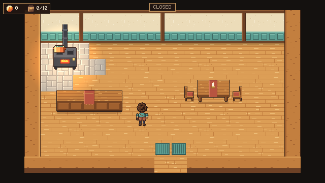
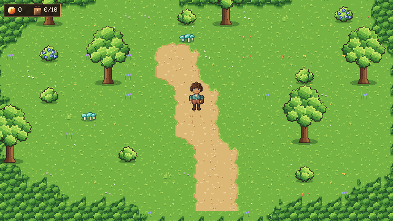
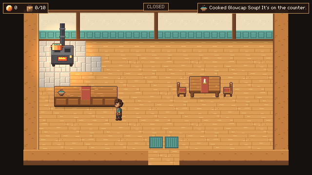
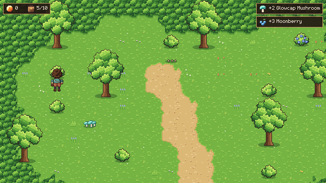
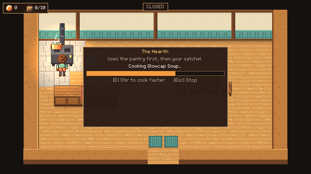
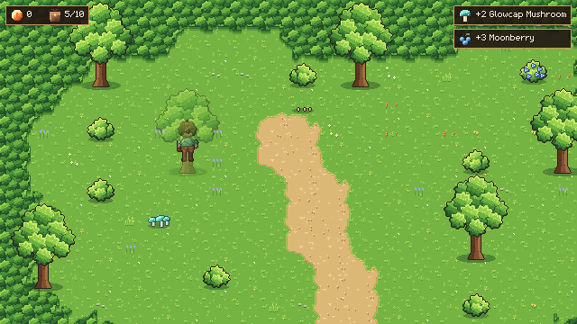

# Copperfern art benchmark v001 — review sheet

**Status: benchmark for owner review (gate G2). Not approved production art.**
Branch `feat/copperfern-benchmark`. All pixels are original, authored natively by the scripts in
`tools/art/copperfern/` (hand-placed pixel maps for the character; hand-designed cluster stamps for
foliage, terrain and furniture). No generated illustration was downscaled; no third-party art used.

## Play it
`"<Godot 4.7.2>" --path . res://scenes/benchmark/copperfern/copperfern_benchmark.tscn`
(or open the scene in the editor and press F6). New Game → the Copperfern tavern; walk out the
south door to the clearing; gather glowcaps and moonberries; back inside, cook at the stove. The
benchmark stocks one fernleaf and one sweetroot so those ingredients complete a recipe. It uses its
own save file. The shipped slice (`main.tscn`) is unchanged.

## Delivered assets (`assets/art/benchmark/copperfern/`)
| Asset | Size | Notes |
|---|---|---|
| `player_walk_v001.png` | 288×256 | 6-frame walk, rows south/west/east/north, 48×64 cells, anchor (24,58), 10 fps |
| `player_idle_v001.png` | 96×256 | 2-frame breathing idle, 2 fps |
| `player_runtime_v001.png` | 384×256 | idle0 idle1 walk0–5 per row (Godot player) |
| `forest_terrain_v001.png` | 512×128 | dual-grid grass↔path and grass↔forest-mass transitions + variants |
| `forest_decor_v001.png` | 192×32 | daisies, buttercups, coral flowers, tall grass, lavender, pebbles |
| `tree_round_v001.png`, `bush_v001.png` | 80×100, 36×30 | tree fades when the player walks behind |
| `glowcap_{full,empty}_v001.png`, `moonberry_{full,empty}_v001.png` | 32×28, 36×30 | two gatherables, full/picked |
| `tavern_tiles_v001.png` | 256×64 | honey planks, flagstones, doormat, plaster/teal wainscot wall, timber posts, wall tops |
| `counter_v001.png`, `table_v001.png`, `chair_v001.png` | 132×52, 68×52, 24×32 | high top-down: large tops, shallow fronts |
| `stove_v001.png`, `stove_fire_v001.png`, `copper_pot_v001.png` | 56×92, 3×18×8, 26×20 | cooking station; fire animates, pot bobs and steams while cooking |
| `copperfern_benchmark_v001.json` | — | metadata: rows, fps, anchor, palette revision, SHA-256 |

Build validation (in `build_copperfern.py`): every frame non-empty, feet exactly on the baseline,
binary alpha only, exact sheet sizes.

## Evidence (real Godot 4.7.2 frames, 640×360, `tests/visual/capture_copperfern.tscn`)
- Animations: [sheet walk + idle, all directions](copperfern_v001/anim_player_sheet_walk_idle_x4.gif) ·
  [in-engine walking in the forest](copperfern_v001/anim_player_ingame_forest_walk_x3.gif) ·
  [in-engine walking in the tavern](copperfern_v001/anim_player_ingame_tavern_walk_x3.gif)
- [Reference vs in-game](copperfern_v001/compare_reference_vs_ingame.png) ·
  [labelled player sheet](copperfern_v001/player_sheet_labeled_x4.png) ·
  [kit contact sheet](copperfern_v001/kit_contact_sheet_x3.png)

| | |
|---|---|
|  |  |
|  |  |
|  |  |

## What was tested
- `tools/run_tests.sh`: strict import clean, all tests pass (incl. new `test_copperfern_benchmark`:
  Copperfern sheet + 6-frame walk via real input, walk out/in through doors, gather with interact,
  cook at the stove onto the counter, separate save file) and the unchanged slice suite.
- Walked all four directions in both areas (captures above); Y-sort in front of/behind counter,
  table, stove and trees; tree canopy fade; foot collisions on all furniture.

## Revisions made before presenting
Hair reduced from a shoulder-length mane to short curls (face was unreadable) · boots reattached
and outlines de-doubled (validator caught feet 1 px low) · leaf clumps reshaded (flat "broccoli"
facets) · forest mass darkened (blended with walkable grass) · tavern floor calmed (busy stripes) ·
furniture wood darkened one step (blended with the floor) · moonberries enlarged (bush did not
read as an ingredient) · path given an S-bend.

## Honest gaps vs the approved reference
- Reference grass is more golden-lime with more ground variety; ours is slightly cooler and plainer.
- Forest-mass tile repeats visibly every 32 px where no trees stand in front of it.
- The tavern reads emptier than the reference because shelves, barrels, plants and wall décor were
  outside this benchmark's scope.
- Walk cycle is functional but simple (no shoulder counter-rotation; side arm swing is small).
- Item icons on the counter and all UI are the slice's older placeholders, not Copperfern.
- Editable source is code (Python) rather than Aseprite/ORA layers; no layered editor was available.

## Decision requested
Approve the 640×360 / 32 px / 48×64 profile and this construction quality as the bar for G3 (a
reusable kit), or name what must change first.
