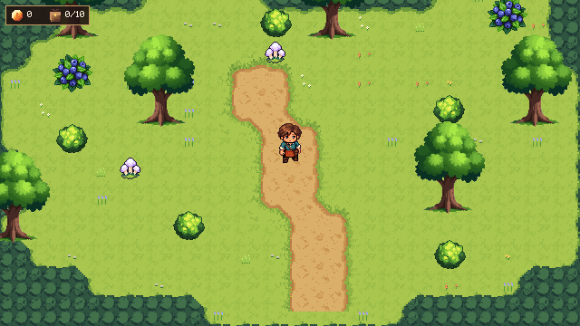
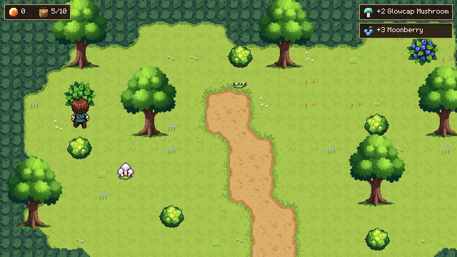
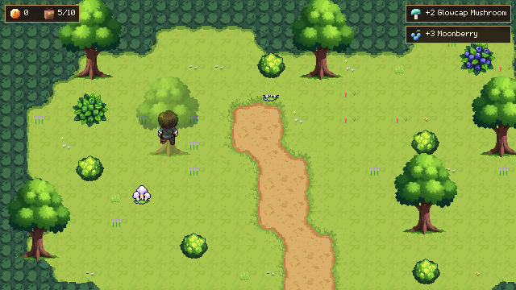
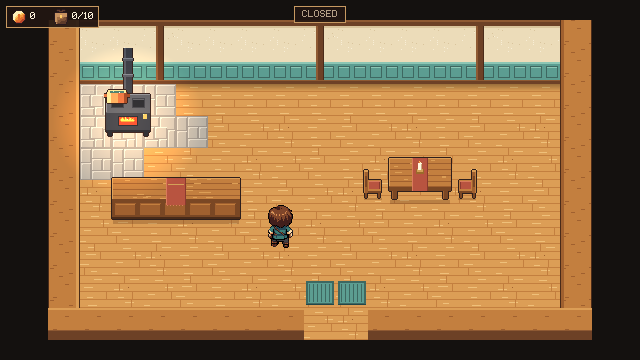

# Copperfern art benchmark v002 — review sheet

**Status: benchmark for owner review. Not approved production art.** Branch `feat/copperfern-benchmark`.
v001 (pixels authored purely in Python/Pillow) was rejected by the owner. v002 rebuilds the
keeper and the forest with real pixel-art tools; the tavern is still v001 apart from one style probe.

## Toolchain used
| Tool | Version / licence | Used for |
|---|---|---|
| GPT image generation (via OhMyGame Studio) | owner's provider | one gameplay **mockup** — concept target only, no pixels used in game |
| PixelLab MCP (`api.pixellab.ai/mcp`) | trial account, 18 generations | keeper (v3 character, high top-down, 52 px) + walk/idle template animations; Wang tilesets; map objects |
| LibreSprite | 1.3, GPL-2.0 | keeper: loads the cleaned frame sequence, saves the editable `.ase`, exports the runtime sheet via CLI |
| Pixelorama | 1.2.4, MIT | installed; not needed in this pass |
| Python/Pillow | — | orchestration only: frame placement, palette remap, validation. No pixels drawn |

## Play it
Open `res://scenes/benchmark/copperfern/copperfern_benchmark.tscn` in Godot 4.7.2 and press F6
(or `"<godot>" --path . res://scenes/benchmark/copperfern/copperfern_benchmark.tscn`). New Game →
tavern; walk out the south door to the clearing; gather glowcaps and moonberries. Separate save file.

## Visual target
[GPT mockup](../../art-direction/mockups/copperfern_gameplay_mockup_v002.png) ·
[mockup vs v001 vs v002](copperfern_v002/compare_mockup_v001_v002.png)

## Delivered (`assets/art/benchmark/copperfern_v002/`)
| Asset | Built by | Notes |
|---|---|---|
| `player_runtime_v002.png` 480×256 (+ `.json`) | PixelLab → `tools/art/copperfern_v002/assemble_keeper.py` → LibreSprite | rows S/W/E/N; idle0–3 (4 fps), walk0–5 (10 fps); 48×64 cells, feet anchor (24,58) |
| `source/player_keeper_v002.ase` | LibreSprite | editable 40-frame source; open in LibreSprite/Aseprite |
| `forest_terrain_v002.png` 512×128 | PixelLab Wang tilesets → `assemble_forest_tiles.py` | grass↔path and grass↔undergrowth, DualGrid layout, palette-corrected |
| `tree_round_v002.png`, `bush_v002.png` | PixelLab map objects | tree fades when walked behind |
| `glowcap_{full,empty}_v002.png`, `moonberry_{full,empty}_v002.png` | PixelLab map objects → `assemble_forest_props.py` | empty states derived (caps removed / berries recoloured to leaves) |
| `source/pixellab_*` | PixelLab raw downloads | kept unmodified as the generation record (Godot-ignored) |

Cleanup applied to generator output (all scripted, reproducible, listed in the assemble scripts):
south idle frame 2 was drawn facing away → replaced by frame 0 · north walk carried a grey ground
shadow and a lime belt artefact → removed/recoloured · tile palette: meadow was acid yellow-green
(#d5f600) and undergrowth cool emerald → remapped by luminance rank onto the approved Copperfern ramps.

## Evidence (real Godot 4.7.2 renderer, 640×360)
- [keeper sheet, idle + walk, all directions](copperfern_v002/anim_keeper_sheet_idle_walk_x4.gif) ·
  [walking in the forest](copperfern_v002/anim_keeper_ingame_forest_walk_x3.gif) ·
  [walking in the tavern](copperfern_v002/anim_keeper_ingame_tavern_walk_x3.gif) ·
  [sheet x3](copperfern_v002/keeper_sheet_x3.png)

| | |
|---|---|
|  |  |
|  |  |

Tavern style probe (PixelLab, not integrated): `source/pixellab_props/stove.png`.

## Tested
`tools/run_tests.sh` → 178 passed, ALL CHECKS PASSED (strict import clean). The benchmark test now
asserts the v002 sheet, 10 columns, 4 idle frames, and that walking only shows walk columns.
Real-renderer captures of every screenshot above.

## Honest gaps
- **Tavern is still v001 art** (floor, walls, counter, table, chair, stove). The PixelLab trial
  allows ~20 generations/day; today's budget went to the keeper (12) and the forest (6). The stove
  probe shows the tavern style PixelLab can reach; its fire is baked in, so integrating it means
  either a separate fire animation or dropping the fire overlay.
- Small decor tiles (flowers, pebbles), item icons, and UI are still the older placeholder art.
- Pure grass/undergrowth have one drawn tile each, so large open areas repeat every 32 px.
- The moonberry bush is drawn closer to straight-down than the tree/keeper's high top-down angle.
- Licence: PixelLab output is governed by PixelLab's terms; confirm that trial-tier output is
  cleared for commercial release before any of it ships.

## Decision requested
1. Is this keeper (proportions, palette, animation) the direction for the player character?
2. Is the forest (tiles + props) at the quality bar for a reusable kit?
3. Next PixelLab budget: the tavern set (floor, wall, counter, table, chair, stove) ≈ 8–10 generations.
