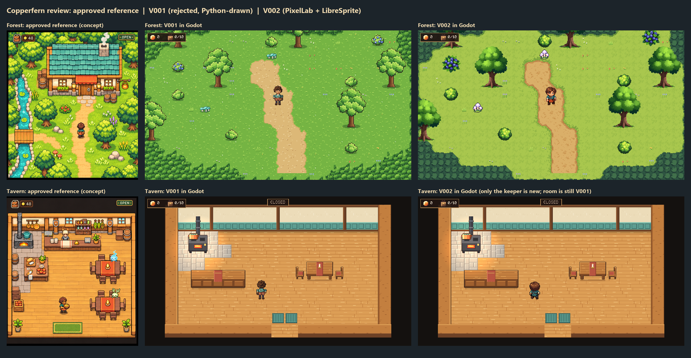
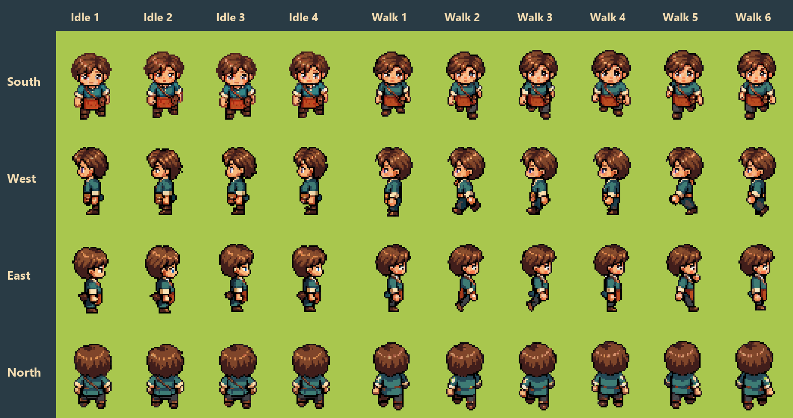
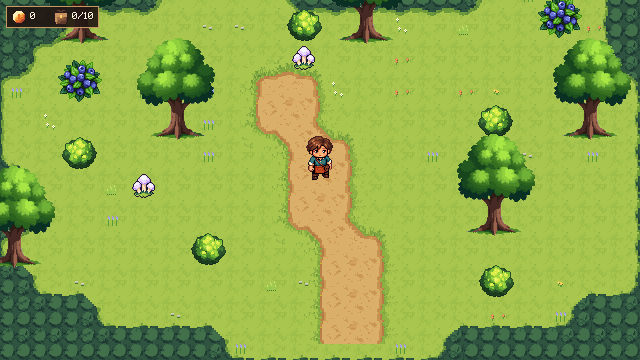
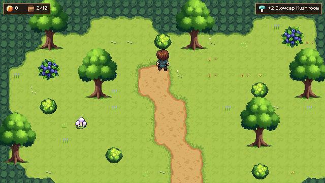
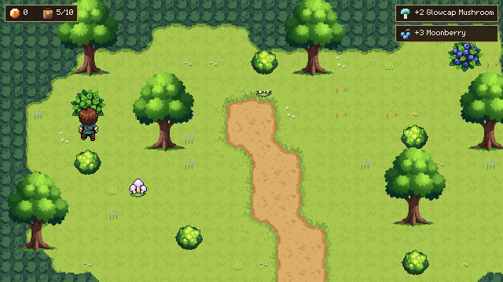
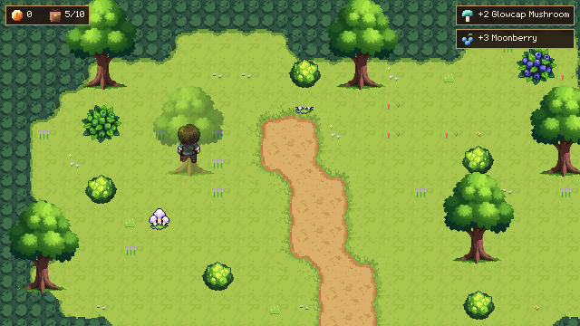
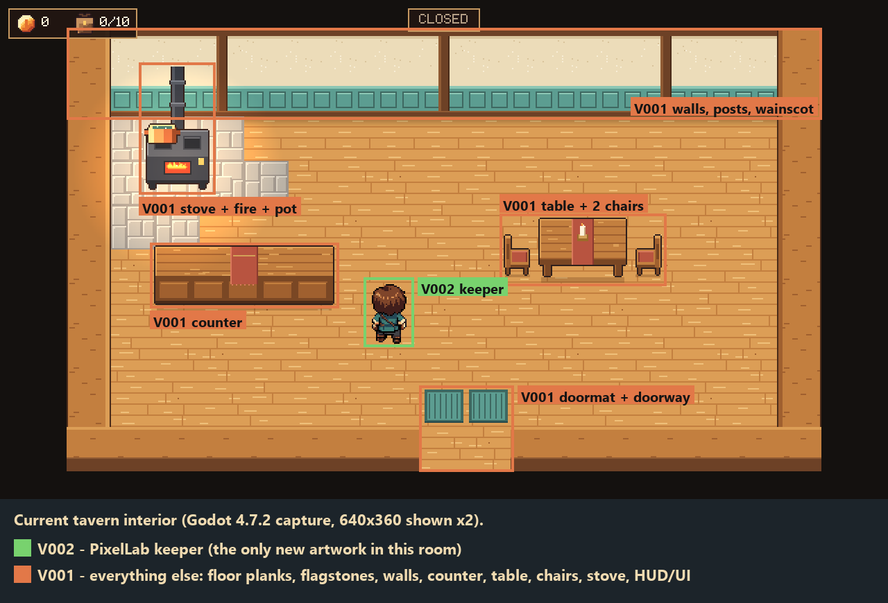

# Copperfern V002 — visual review pack

Everything below is captured from Godot 4.7.2 running the benchmark scene, except the approved
reference (concept art). No new assets were generated for this pack. Details and provenance:
[COPPERFERN_BENCHMARK_V002.md](COPPERFERN_BENCHMARK_V002.md).

## 1. Approved reference vs V001 vs V002

## 2. Player character — 4 directions, idle and walk

- Animated, from the sheet: [anim_keeper_sheet_idle_walk_x4.gif](copperfern_v002/anim_keeper_sheet_idle_walk_x4.gif) (left four: idle; right four: walk)
- Animated, in game: [forest](copperfern_v002/anim_keeper_ingame_forest_walk_x3.gif) · [tavern](copperfern_v002/anim_keeper_ingame_tavern_walk_x3.gif) (down, left, right, up)
- Known detail: the north walk frames are drawn ~2 px taller than the north idle frames, so the head shifts slightly when walking north starts.

## 3. Forest (V002 PixelLab terrain, trees, bushes, gathering objects)
| | |
|---|---|
|  path, meadow, undergrowth edge, trees, bushes, both gatherables |  glowcap picked (stubs remain) |
|  moonberry picked (leaves only) |  keeper behind a tree (canopy fades) |

Still V001 in the forest: the tiny decor tiles (flowers, pebbles, grass tufts), item icons, HUD.

## 4. Tavern (current interior)

Only the keeper is V002. Floor, flagstones, walls, counter, table, chairs, stove/fire/pot, doormat and
HUD are V001.

## 5. Gameplay preview
- Video (23 s, 1280×720, 30 fps): [gameplay_preview_v002.mp4](copperfern_v002/gameplay_preview_v002.mp4)
- Same as GIF: [gameplay_preview_v002.gif](copperfern_v002/gameplay_preview_v002.gif)

Scripted with the real input actions (`tests/visual/tour_copperfern.tscn`, recorded with Godot's
`--write-movie`): tavern walk → out the door → up the forest path → gather glowcaps → cross to the
moonberry bush and gather → walk back past and behind the trees.
